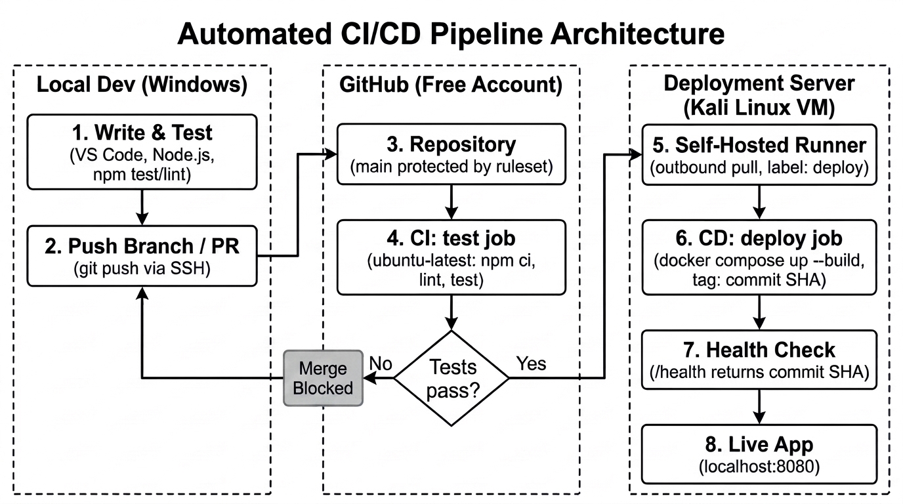

# ITSD 85 Lab <no>: Automated CI/CD Pipeline

Student(s): <full names> Section: <section> Instructor: <name>

## What this project does

A minimal Node.js (Express) web API with automated tests (`node:test`), linting (`eslint`), Docker packaging, and a GitHub Actions CI/CD pipeline that tests on a GitHub-hosted runner and deploys to a self-hosted Ubuntu Server VM via Docker Compose.

## Pipeline diagram



## How to run locally

```bash
npm install
npm run lint
npm test
npm run dev
```

Open `http://localhost:3000` and `http://localhost:3000/health`.

## How the deployment works

1. Every push or pull request to `main` triggers the `test` job on `ubuntu-latest` (`npm ci`, `npm run lint`, `npm test`).
2. Only pushes to `main` (after `test` passes) trigger the `deploy` job on the self-hosted runner (`[self-hosted, linux, deploy]`).
3. The runner builds and starts the container with `APP_VERSION=${{ github.sha }}` and verifies `http://localhost:8080/health` returns the new commit SHA.

## Results

| Test | Expected result | Actual result | Push-to-live time (min:sec) | Screenshot no. |
| --- | --- | --- | --- | --- |
| A – good change | test ✓, deploy ✓, new name and commit ID live | | | |
| B – broken change | test ✗, merge blocked, server unchanged | | n/a | |
| C – rollback (Method 1) | old content and a new commit ID live | | | |
| C – rollback (Method 2) | previous commit ID live within seconds | | | |

## Screenshots

- [Checkpoint 1](docs/screenshots/cp1-versions.png)
- [Checkpoint 2](docs/screenshots/cp2-tests-dev.png)
- [Checkpoint 3](docs/screenshots/cp3-github-repo.png)
- [Checkpoint 4](docs/screenshots/cp4-ci-green.png)
- [Checkpoint 5](docs/screenshots/cp5-vm-manual.png)
- [Checkpoint 6](docs/screenshots/cp6-deploy-green.png)

## Paper

- [Final Paper PDF](docs/paper.pdf)
